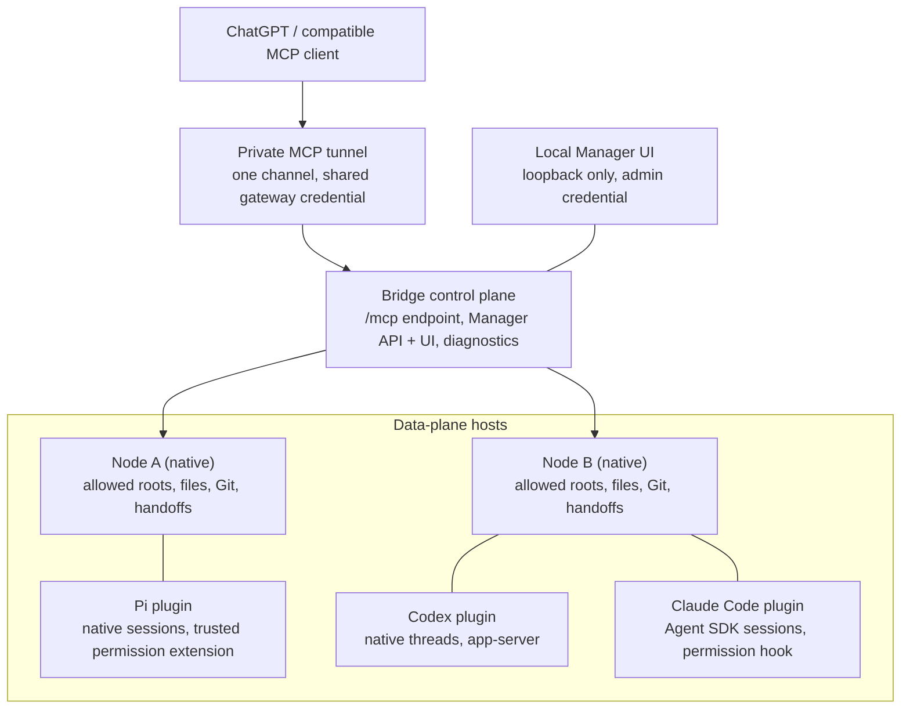
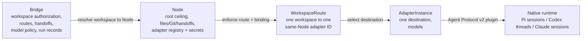
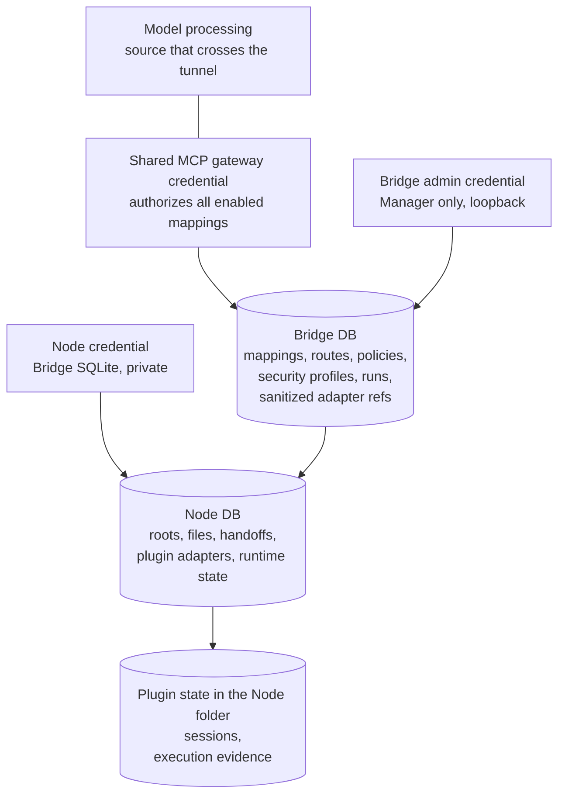
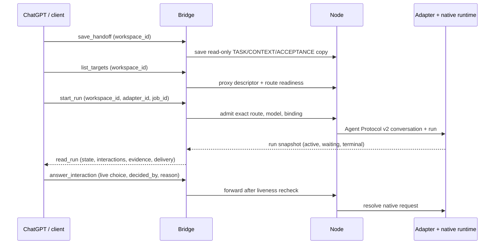
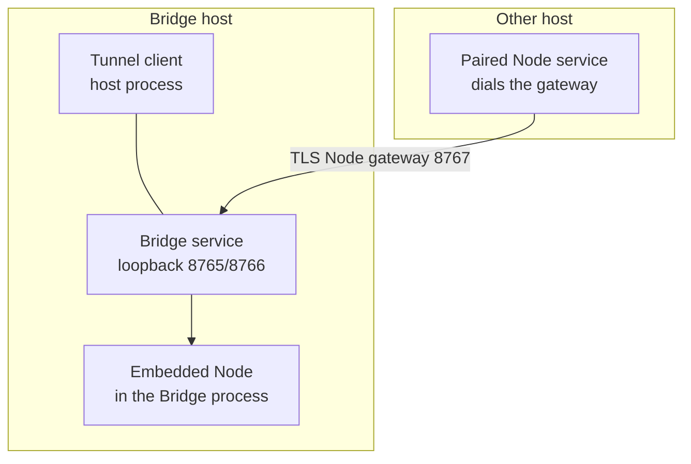

# Architecture

Source-accurate reference for Workspace Bridge: Bridge control plane
plus local Manager, authoritative Nodes, Node-supervised agent plugins
(Claude Code, Codex, OpenCode, Pi), exact workspace routes, Agent Protocol
v2, optional secure MCP tunnel, native services on macOS and Linux, manual
package updates, and bounded logs.

## Component and deployment topology

Component responsibilities:

- `api.py`: strict typed tool schemas, the MCP server on the official MCP
  Python SDK (24 tools plus the skills extension), and the loopback Manager
  API.
- `service.py`: auth, mappings, Node-routed operations, handoff publication,
  write policy, adapter references, workspace routes.
- `node_service.py` / `node_api.py`: Node data plane (allowed roots, files,
  images, Git, handoffs, plugin adapters).
- `edit_journal.py`: the Node's staged, all-or-nothing `apply_patch` and its
  journal for `undo_edit`.
- `plan_files.py`: the Node's read-only handoff copies and its
  content-addressed image uploads, both in Node state.
- `pairing.py` / `node_gateway.py` / `node_link.py`: pairing strings, the
  Bridge's TLS Node gateway, and the paired Node's dial-out loop.
- `os_service.py` / `oplog.py`: one launchd or systemd service definition
  for the Bridge and the Node, and their size-capped service logs.
- `node_registry.py` / `node_client.py`: Bridge-side Node inventory and
  bounded Node protocol proxy.
- `adapter_registry.py`: sanitized Bridge cache of Node-owned instances with
  on-demand Node runtime proxying.
- `diagnostics.py`: sole server-side evaluator for the canonical diagnostic
  report and runnable-route model, shared by Doctor and the admin API.
- `git_evidence.py`: bounded read-only Git status and diff collection.
- `checkpoint_store.py`: Node-owned shadow Git store per workspace for run
  checkpoints, filled through SafeRoot reads; never writes the workspace or its
  `.git`.
- `run_checkpoints.py`: Bridge pre/post capture hooks, durable post-capture
  worker, retention, and run-diff reads. Stores IDs, statuses and bounded
  change summaries only.
- `run_coordinator.py`: adapter-ID-keyed conversations, runs, interactions,
  and activity persistence plus reconciliation for Runtime Protocol v1.
- `adapter_events.py`: bounded event readers keyed by exact Node/adapter
  authority. Native events trigger snapshot reconciliation, with periodic
  polling retained for recovery and adapters without event support.
- `manager_events.py`: bounded, process-local Manager SSE hints containing
  run IDs. Reconnects and queue overflow request a REST snapshot refresh;
  this stream has no durable event replay or runtime content.
- `wbrp.py`: validated bounded runtime client for agent plugins.
- `plugin_protocol.py` / `plugin_supervisor.py` / `plugin_host.py`: Agent
  Protocol v2 framing and manifests, the Node's plugin supervisor, and the
  plugin side for the Python agents.
- `codex_host_adapter.py` / `codex_rpc.py`: Codex app-server host adapter
  with native thread ownership.
- `claude_host_adapter.py`: Claude Code host adapter over the Claude Agent
  SDK with adapter-owned sessions, a closed tool list, and a pre-tool
  permission hook.
- `runtime/pi-host-adapter/`: Pi adapter around natively hosted Pi sessions,
  including its trusted permission extension.
- `notifications.py`: Bridge-owned semantic events, durable per-channel
  outbox, named channel adapters (Discord configured from local environment).
- `event_broker.py` / `event_protocol.py`: durable subscriptions over the same
  notification journal, identity-only event projection and a separate webhook
  outbox using the documented MCP 2.0 event contract. `webhook_transport.py`
  signs and verifies callbacks with DNS-pinned public HTTPS connections.
  See [Events](EVENTS.md).
- `security.py`: shared validation primitives (traversal, exclusions,
  bounded reads, publication, hash-checked writes).
- `media.py` / `image_worker.py`: typed image results and a fixed, timed
  decoder for authorized bytes.
- `browse.py`: live trees, globs, bounded search with signed cursors and
  hashes.
- `embedded_skill.py` plus `skills/project-lead/SKILL.md`: packaged
  project-lead guidance served through the MCP skills extension.
- `web/` plus `static/dist/`: Manager source and compiled assets served by
  Starlette on the same loopback listener. `web/src/features/runs/` separates
  the Run Inspector, API loaders, feed presentation, state hooks, and SSE
  subscriptions from the main Manager shell.

## Node transports

The Bridge sends the same `/v1/...` Node requests over one of two
transports. `paired` Nodes dial the Bridge's TLS Node gateway, authenticate
with an Ed25519 key, and answer requests over that outbound socket; they open
no listening port. The `local` (embedded) Node runs inside the Bridge
process. Both call one request handler (`node_api.handle`) on the Node,
always from a worker thread. The gateway runs on its own event loop and
thread, because Bridge worker threads wait on it for replies while sometimes
holding the service lock. A paired Node's connection revision derives from
its public key, so reconnecting never strands runs; re-pairing does.

## Authority and data path

A `RuntimeType` (`pi`, `codex`, `claude`, or `opencode`) names the protocol family; it is not a
destination. An `AdapterInstance` is one Node-owned destination with its own
name, plugin and settings, enabled state, and connection revision. A
`WorkspaceRoute` binds one workspace to one exact same-Node adapter ID with
enabled/default state and a security binding: a Bridge security profile or,
for Codex, the agent's native security. Model policy is scoped to the adapter
instance; profiles are Bridge-wide and travel with every run. There is no implicit cross-Node
or runtime-type fallback. The MCP discovery tool returns sanitized adapter
IDs and exact route availability.

Reads flow: shared credential, explicit enabled workspace, authoritative
Node, host ceiling check, bounded untrusted source with pagination. The
Bridge never opens a workspace root itself and never falls back to a local
checkout. Writes flow through the same route plus the mapping's current
write scope (`none` read-only or `workspace` edit), loaded per call. Git evidence
is fixed-function status and diff output and proves no authorship. Run
checkpoints are the one stored copy of source: the owning Node keeps them in
its private state, and the Bridge receives only IDs, statuses and paged diffs.

## Credentials and trust boundaries

Boundaries:

- Bridge credential versus admin credential versus Node credential are
  distinct secrets with distinct storage and entry points (see
  [Setup](SETUP.md)); agent plugins have none. One-time output stays local.
- Bridge DB versus Node DB versus plugin state: the Bridge holds sanitized
  adapter references; the Node holds plugin configuration and data-plane
  state; each plugin holds native sessions in its private folder under the
  Node state. All
  state files are private (`0700` directories, `0600` files).
- Write scope governs ChatGPT's file mutation and checks; exact route
  enablement governs run admission. Handoffs live in Bridge state. One does not imply the other.
- Security profiles are pre-tool policy enforced by each plugin, not OS
  sandboxes. Pi uses its trusted permission extension, Claude Code its tool
  list and permission hook, OpenCode its permission plugin, and Codex its
  read-only sandbox with approvals the plugin decides from the rules. Agents run
  with the host user's authority. Review each profile before routing it.
- Source returned through the tunnel reaches model processing. The tunnel
  removes a public inbound endpoint; it does not keep code local. Exclusions
  and redaction are conservative and heuristic, not complete protection.

## Run and interaction sequence

Admission requires the workspace enabled, the exact same-Node route and
adapter enabled, the handoff prepared in that workspace (or a bounded direct
instruction published as a minimal auditable handoff), an allowed model, a
reachable Node, and a matching conversation binding. Each accepted run stores
an immutable Node/adapter revision plus an effective-security snapshot.
Interactions resolve only against live native requests; persisted copies are
insufficient. Continuation reuses a terminal conversation only after live
ownership proof (exists, same workspace, idle on the current same-Node
adapter). Bridge never replays a prompt or approval on recovery; unconfirmed
operations become interrupted or orphaned with stale interactions.

Adapters that advertise events have their native hints read through the Node.
The coordinator validates instance/cursor and conversation/run bindings before
refreshing authoritative snapshots. Committed projection changes notify the
Manager through an authenticated, bounded SSE connection; unchanged snapshots
emit no refresh hint. The UI reloads run details, interactions, activity, and
execution projections through REST, coalesces bursts, and retains periodic
refresh plus refresh on returning to the visible page. REST continues to own
all control operations. Loaded history stays available while the newest page
overlaps it; a disjoint page after a large burst restarts pagination so records
between the pages remain reachable. See [Runtime Protocol recovery](RUNTIME_PROTOCOL.md#recovery).

## Deployment

The Bridge and its embedded Node run as one host process; agent plugins are
its child processes. A Node on another host runs as its own service and
dials the Bridge's Node gateway, so absolute workspace paths stay those of
the host that owns them. The Manager is loopback-only and is never
tunnelled.

## State ownership and failure domains

- Bridge process failure: in-flight MCP calls fail; durable mappings,
  routes, policies, handoffs records, runs, and notification outbox rows
  persist in Bridge SQLite. Restart reconciles without replaying prompts.
- Node service failure: workspaces on that Node become unavailable and its
  routes stop being ready. Bridge mappings remain but fail closed; no local
  checkout fallback exists. Other Nodes are unaffected.
- Adapter plus native runtime failure: runs on that instance stop making
  progress. The Codex adapter and its owned app-server form one supervised
  unit: unexpected native loss terminates the plugin so the Node restarts
  the whole unit instead of leaving it permanently degraded. Active runs are marked interrupted, never replayed; idle persisted
  conversations remain resumable.
- A slow or hung Node or adapter delays only work on the same key. The
  Bridge's database lock covers SQLite statements only and is never held
  across Node or adapter I/O. File writes and handoff publication serialize
  per workspace, run starts per workspace route, and run input and
  interaction answers per run. Reads, cancels, the Manager and other
  workspaces keep working. The MCP endpoint accepts up to 4 concurrent tool
  calls, so several hung calls can still fill it until their timeouts.
- Notification channel failure never changes run state. Delivery is
  at-least-once across the crash window between remote acceptance and
  persisted confirmation, so one duplicate is possible after restart.

## Service lifecycle

- One module, `os_service.py`, writes the service definition for both the
  Bridge and the Node. The default is a user service: a LaunchAgent under
  `~/Library/LaunchAgents/` on macOS, a systemd user unit under
  `~/.config/systemd/user/` on Linux (starting at boot only with lingering
  enabled). `--root`, run as root, installs a LaunchDaemon or a system unit
  that starts at boot; the service still runs as the account that owns the
  state folder.
- Definitions contain only the launcher (`python -m workspace_bridge.cli
  --state <state> serve` or the Node equivalent) and `WB_SERVICE=1`, never
  tokens or project roots, plus a marker line; a definition without the
  marker is never replaced or removed. Agent plugins are child processes of
  the Node, not services. `service status` combines OS state with a bounded
  health check. `service uninstall` removes only the definition; state,
  keys, bindings, and logs remain.

## Release identity and skew

Every deployed component exposes a bounded content-addressed identity with
product `workspace-bridge`, the product version, component name and
version, and a deterministic build ID over production inputs only. The
product version is the release; the component version is that component's
own version; adapter and native semantic versions stay separate fields.
Targets are read-only: the Manager System / Versions view shows skew with
manual-update guidance and performs no installs. Bridge-first upgrades are
supported; compatible Nodes and adapters may lag until the operator chooses
a maintenance window. Protocol and feature compatibility stay strict, while
malformed optional release metadata is observed as degraded update metadata
without making an otherwise valid descriptor unavailable.

## Logging and extension points

- A managed service writes its own log, `logs/bridge.log` or `logs/node.log`
  in its state folder, rotated at 10 MiB with two previous files kept. The
  service manager's stdout/stderr file only catches what escapes logging and
  is emptied at start past 1 MiB. Foreground `serve` logs to stderr. Logs
  carry bounded IDs, states, counts, and codes only — never prompts, results,
  paths, scopes, credentials, or raw bodies.
- The first time each MCP client name and protocol version is seen after a
  start, the Bridge logs an `mcp_client` line and adds an audit event
  (outcome `<protocol version> <client name>`), so the Manager's event list
  shows which version ChatGPT negotiates. The name is the client's own
  `clientInfo.name` (or `unknown`), reduced to a short safe string.
- Each agent plugin's stderr goes to a private `plugin.log` in its folder,
  capped at 5 MiB with one previous file kept.
- Runtime extension points: new notification channels implement the channel
  interface without changing run orchestration; new agents ship as plugins
  with a manifest and must pass the conformance gate (idle-only admission, exact interaction
  routing, opaque models, ownership, restart reconciliation) without changing
  the coordinator state machine, schema, or workspace authorization.
- Image path caveat: supported rasters decode in a fixed, timed worker and
  return native MCP previews alongside metadata. Previews are first-frame,
  size-bounded, re-encoded, metadata-stripped, and not color-managed; pixel
  secrets are not detected. A local tool success does not prove a given
  tunnel client passes pixels to the model.

## Intentional non-goals

No general shell execution, Git mutation, automatic source-write enablement,
snapshot audit, arbitrary binary readers, public OAuth, per-chat ACL,
background scheduling, automatic updates, automatic support upload, or
external conformance certification. Skill following and review quality are
model behavior, not enforced guarantees.
